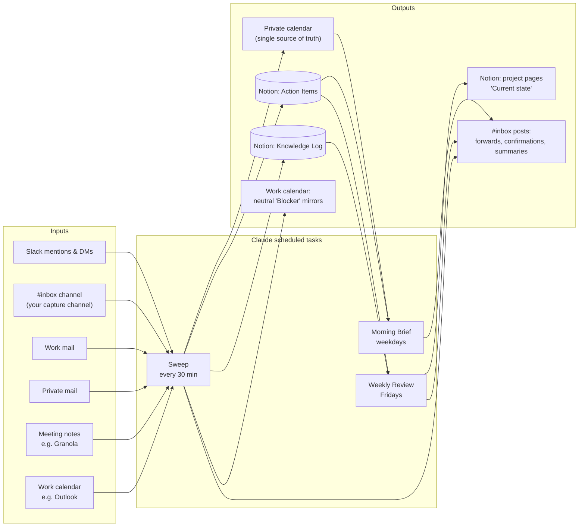

# Cowork Productivity System

**An AI chief-of-staff that runs on scheduled Claude tasks, with no servers and no Zapier/Make.**

It watches your inputs (Slack, work mail, private mail, meeting notes, calendars) every 30 minutes and does three jobs:

1. **Calendar.** It keeps **one calendar as the single source of truth**. Work meetings are mirrored in, color-coded and flagged when you haven't accepted them. Your private time is mirrored back to the work calendar as neutral "Blocker" events. You can write "block Mon Wed Fri 9–11" in Slack and get a conflict check with alternatives.
2. **Tasks.** It turns requests, mentions and meeting action items into **prioritized tasks in Notion**, after you confirm them in a Slack thread (`ok` / `skip` / `knowledge`).
3. **Knowledge.** It builds a **knowledge log per project** from meetings, Slack and your own notes. Once a week it rewrites a "Current state" summary on each project page.

It also posts a **Morning Brief** every weekday and a **Weekly Review** every Friday.

> Built and battle-tested with [Claude Cowork](https://claude.ai) scheduled tasks and MCP connectors. Every "automation" here is a plain-language prompt, so you can read, fork and change it without writing code.

---

## How it works



| Component | Schedule | Writes to |
|---|---|---|
| [`prompts/sweep.md`](prompts/sweep.md) | every 30 min, working hours (2 tasks, offset by 30 min) | calendars, Notion, #inbox |
| [`prompts/morning-brief.md`](prompts/morning-brief.md) | weekdays, before work | #inbox (optionally a KPI database) |
| [`prompts/weekly-review.md`](prompts/weekly-review.md) | Friday afternoon | project pages, #inbox |
| [`prompts/chat-instructions.md`](prompts/chat-instructions.md) | in interactive chats | same rules when you talk to Claude directly |

---

## What you need

| Required | Optional |
|---|---|
| Claude plan with **Cowork + scheduled tasks** | **Meeting notes**: Granola, or any notes connector |
| **Notion** connector | **Second (work) calendar**: Microsoft 365 / Outlook, or another Google account |
| **Slack** connector + one private channel for yourself | **Private mail**: Gmail |
| **Google Calendar** connector | **KPI source**: Google Sheets / Metabase for the brief |

Nothing runs on your machine. Each task is a fresh cloud session that uses your connectors.

---

## Quickstart (about 45 minutes)

1. **Fork or download** this repo.
2. `cp config/config.example.yaml config/config.yaml` and fill in your values. The [setup guide](docs/02-setup-guide.md) explains where to find each ID.
3. Create the Notion databases from [`notion/schemas.md`](notion/schemas.md). You can paste the "Create with Claude" prompt into a chat and Claude builds them for you.
4. Render the prompts with your config:
   ```bash
   pip install pyyaml
   python scripts/render_prompts.py   # writes build/*.md
   ```
5. In Claude, create the scheduled tasks and paste each prompt from `build/`. Schedules are in [setup guide §6](docs/02-setup-guide.md#6-create-the-scheduled-tasks).
6. Paste `build/chat-instructions.md` into your Claude Project's instructions or docs.
7. Post `block tomorrow 10-12` in your inbox channel and wait for the next run.

---

## Documentation

| Doc | What's inside |
|---|---|
| [01 – Architecture](docs/01-architecture.md) | Design decisions, data flow, why it's built this way |
| [02 – Setup guide](docs/02-setup-guide.md) | Step-by-step setup, finding IDs, creating tasks |
| [03 – Calendar sync](docs/03-calendar-sync.md) | Two-calendar model, markers, colors, loop protection, blocker commands |
| [04 – Capture & tasks](docs/04-capture-and-tasks.md) | Forward flow, inbox commands, deduplication |
| [05 – Knowledge base](docs/05-knowledge-base.md) | Knowledge log, project pages, weekly "Current state" |
| [06 – Customization](docs/06-customization.md) | Adapting projects, languages, sources, KPIs |
| [07 – Troubleshooting](docs/07-troubleshooting.md) | Lessons learned and known limits |
| [Cheat sheet](docs/cheat-sheet.md) | Every command you can type in Slack |
| [Example: growth marketing](examples/growth-marketing/) | A full config for a paid-social / funnel role |

---

## Design principles

- **One source of truth per thing.** Calendar → your private calendar. Tasks → Notion. Knowledge → Notion knowledge log.
- **Human in the loop for tasks.** Requests from others are *proposed* in Slack and only become tasks after `ok`.
- **Read-only where it matters.** Real work meetings are never changed, accepted or declined. Only the system's own mirror events are touched.
- **Idempotent.** Every write is deduplicated by a marker or link, so overlapping or repeated runs don't create duplicates.
- **Quiet by default.** A run that finds nothing posts nothing.

## Authors

Published by **[Kii003](https://github.com/Kii003)** and **Claude** (Anthropic), designed and built together in Claude Cowork.

## License

MIT. See [LICENSE](LICENSE).
